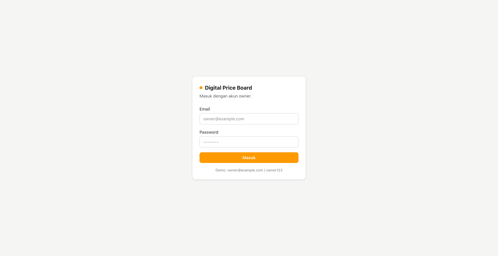
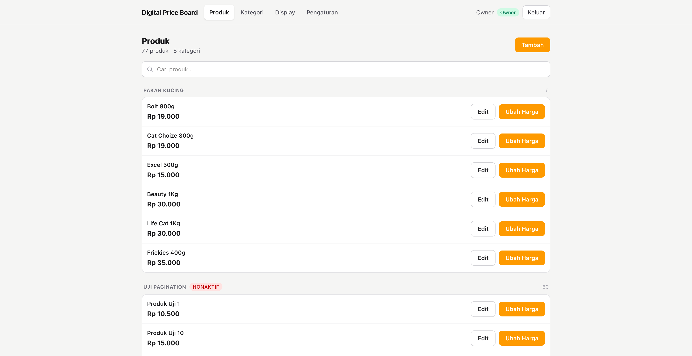
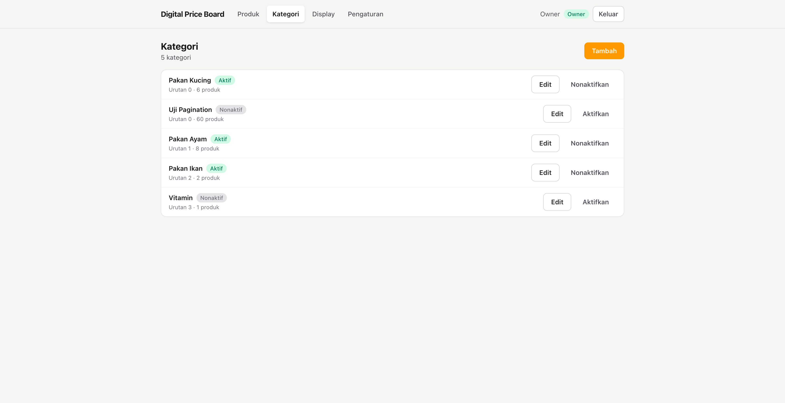
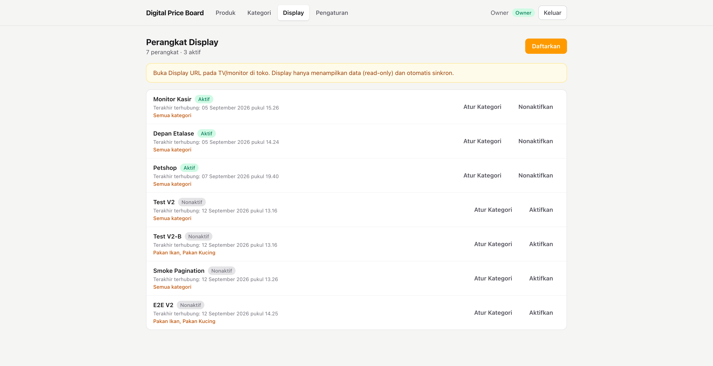
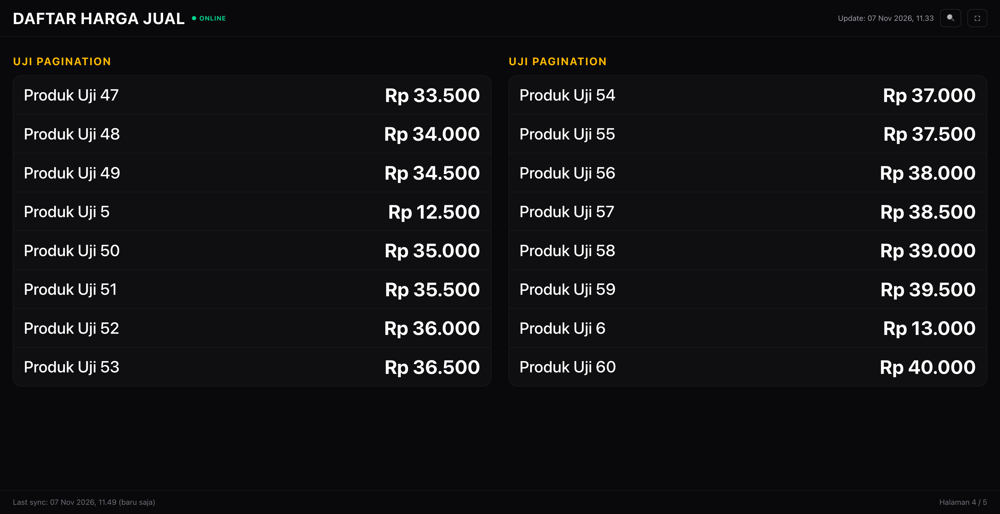

# Digital Price Board

Aplikasi internal untuk toko pakan: menyimpan daftar produk beserta harga jualnya, memungkinkan owner mengubah harga kapan saja dari HP/perangkat lain, lalu menampilkan harga terbaru pada monitor/TV/tablet di toko. Setiap perubahan harga tercatat dalam riwayat.

> **Bukan sistem POS.** Aplikasi tidak mengelola transaksi penjualan (stock, pelanggan, supplier, dsb.). Fokus V1: **Price Management + Price Display**.

Dokumentasi lengkap:

- System Plan V1.2: [`docs/Digital-Price-Board-System-Plan-V1.2.md`](docs/Digital-Price-Board-System-Plan-V1.2.md)
- System Plan V2 (refined): [`docs/Digital-Price-Board-System-Plan-V2-refined.md`](docs/Digital-Price-Board-System-Plan-V2-refined.md)

**Status saat ini:** V1 selesai. V2 **Stage 1** (kategori per perangkat display), **Stage 2** (pagination display otomatis), dan fitur hapus data (produk, kategori, perangkat display) sudah diimplementasikan.

---

## Screenshot

**Login owner**



**Daftar produk (dikelompokkan per kategori)**



**Kelola kategori**



**Perangkat display (owner)**



**Tampilan display di toko (dengan pagination)**



---

## Fitur

**Owner (mobile-first)**
- Login/logout + sesi dengan masa berlaku via env (`SESSION_MAX_AGE`)
- Ganti password sendiri (verifikasi password lama, tanpa forgot-password)
- Kelola kategori (buat/edit/aktif-nonaktif/urutan/hapus)
- Kelola produk (buat/edit/cari/aktif-nonaktif/urutan/hapus)
- Ubah harga jual cepat (one-step, tanpa buka halaman detail)
- Riwayat perubahan harga per produk
- Kelola perangkat display (daftarkan, token sekali pakai, aktif-nonaktif, hapus, last seen)
- **Hapus data:** produk dihapus secara *soft delete* (tidak tampil lagi, riwayat harga tetap tersimpan). Kategori hanya bisa dihapus jika tidak punya produk, termasuk produk yang sudah dihapus. Perangkat display dihapus permanen dan tokennya langsung tidak berlaku.
- Tombol aksi memakai ikon dengan label
- **Atur kategori per perangkat display** (V2 Stage 1): tampilkan semua kategori aktif, atau pilih kategori tertentu per layar (mis. layar kasir hanya "Pakan Ikan" dan "Pakan Kucing")

**Display (read-only)**
- Halaman display per token: `/display/<token>`
- Grup produk per kategori, tipografi besar, high readability
- **Pagination otomatis** (V2 Stage 2): produk yang tidak muat satu layar dibagi ke beberapa halaman, menyesuaikan tinggi dan lebar layar; kategori yang terpotong dilanjutkan dengan header yang diulang
- **Rotasi halaman** tiap `DISPLAY_ROTATE_SECONDS` detik, dengan indikator "Halaman x / y"
- Sinkronisasi otomatis (polling 60 detik)
- Offline fallback: tetap menampilkan data terakhir (localStorage) + peringatan `Last sync`
- Pencarian produk (rotasi berhenti saat pencarian aktif) + tombol fullscreen
- Footer: waktu `Last sync`, indikator halaman, dan kredit "Created by Japrasetya"

---

## Tech Stack

| Layer | Teknologi |
|---|---|
| Frontend | Next.js 16 (App Router), React 19, Tailwind CSS v4, TypeScript |
| Backend | Next.js Route Handlers (monolith), Zod validation |
| Database | MySQL 8.4 (Docker Compose) |
| ORM | Prisma 7 (driver adapter `@prisma/adapter-mariadb`) |
| Auth | JWT session (`jose`), hashing `bcryptjs`, token display HMAC-SHA256 |
| Container | Docker / Docker Compose (`node:24-alpine`) |

---

## Struktur Proyek

```
src/
├── app/
│   ├── (auth)/login/            # halaman login owner
│   ├── (dashboard)/             # shell owner + products/categories/display-devices/settings
│   ├── (display)/display/[token] # layar harga toko
│   └── api/                     # Route Handlers (auth, categories, products, display)
├── components/
│   ├── ui/                      # primitives (Button, Input, Modal, Badge, dsb.)
│   ├── products/ categories/ settings/ shell/
│   └── display/                 # display-screen, paged-grid (algoritma pagination), device-manager
├── lib/
│   ├── auth/                    # session, password, DAL, display-token
│   ├── db/                      # Prisma client singleton
│   ├── errors/                  # format error API (Section 39 System Plan)
│   ├── services/                # logika bisnis (product, price)
│   ├── validation/              # skema Zod
│   ├── client/                  # fetchJSON client-side
│   └── utils/                   # format Rupiah/tanggal, dsb.
├── proxy.ts                     # route guard (protected/public)
prisma/
├── schema.prisma                # users, categories, products, price_histories, display_devices
├── migrations/                  # migrasi database (init + display_category_selection)
└── seed.ts                      # seed awal (owner + contoh data)
scripts/
└── verify-pagination.ts         # uji algoritma pagination display
docs/                            # System Plan V1.2 & V2
public/screenshot/               # screenshot untuk dokumentasi ini
Dockerfile · docker-compose.yml · docker-entrypoint.sh
```

---

## Persyaratan

- Node.js 24+
- Docker + Docker Compose (untuk MySQL dan/atau menjalankan app)
- npm 10+

---

## Setup Pengembangan

### 1. Konfigurasi environment

```bash
cp .env.example .env
```

Edit `.env`, minimal ganti nilai placeholder:

- `MYSQL_ROOT_PASSWORD`, `MYSQL_PASSWORD` — kata sandi DB
- `AUTH_SECRET`, `DISPLAY_TOKEN_SECRET` — generate dengan:

```bash
openssl rand -base64 32   # jalankan dua kali
```

> `.env` tidak boleh di-commit (sudah di `.gitignore`).

### 2. Jalankan database

```bash
npm run db:up          # docker compose up -d (MySQL di port 3307)
```

> Port host `3307` dipakai untuk menghindari konflik dengan instalasi MySQL lain; port internal container tetap `3306`.

### 3. Instal dependencies + migrasi + seed

```bash
npm install
npm run db:migrate     # prisma migrate dev
npm run db:seed        # membuat owner default + data contoh
```

### 4. Jalankan app

```bash
npm run dev            # http://localhost:3000
```

**Login default hasil seed:**

| Field | Nilai |
|---|---|
| Email | `owner@example.com` |
| Password | nilai `SEED_OWNER_PASSWORD` di `.env` (default dev: `owner123`) |

---

## Menjalankan dengan Docker (production-like)

Satu perintah untuk seluruh stack (DB + app):

```bash
docker compose up -d --build
```

Behavior:

- `db` (MySQL 8.4) menunggu healthy → `app` mulai
- Entrypoint `app` otomatis menjalankan `prisma migrate deploy` sebelum `next start`
- Seed hanya berjalan jika `SEED=1` di `.env` (nyalakan saat deploy DB kosong pertama kali)
- App berjalan sebagai user non-root (`nextjs`)

Jalankan seed manual di container (jika perlu):

```bash
SEED=1 docker compose up -d --force-recreate app
```

Log:

```bash
docker compose logs -f app
```

---

## Variabel Environment

| Variabel | Wajib | Keterangan |
|---|---|---|
| `MYSQL_ROOT_PASSWORD` | ✓ (compose) | Root password MySQL |
| `MYSQL_DATABASE` | ✓ (compose) | Nama database |
| `MYSQL_USER` / `MYSQL_PASSWORD` | ✓ (compose) | User aplikasi DB |
| `MYSQL_PORT` | – | Port host MySQL (default `3307`) |
| `DATABASE_URL` | ✓ | Koneksi Prisma (dipakai saat run di host / migrate) |
| `APP_URL` | ✓ | URL publik; dipakai membangun `displayUrl` saat daftarkan perangkat display. Skema `https://` mengaktifkan atribut `Secure` pada cookie sesi; `http://` untuk dev/akses LAN lokal |
| `AUTH_SECRET` | ✓ | Secret sign JWT sesi owner |
| `DISPLAY_TOKEN_SECRET` | ✓ | Secret HMAC token display |
| `SESSION_MAX_AGE` | ✓ | Durasi sesi owner dalam detik (tidak di-hardcode) |
| `DISPLAY_MODE` | – | Mode display: `pages` (default; satu-satunya mode V2) |
| `DISPLAY_ROTATE_SECONDS` | – | Interval ganti halaman display dalam detik (default `10`) |
| `APP_PORT` | – | Port host untuk app container (default `3000`) |
| `SEED` | – | `1` untuk menjalankan seed saat container start |
| `SEED_OWNER_PASSWORD` | – | Password owner default |
| `SEED_DISPLAY_TOKEN` | – | Token display dev yang di-seed (contoh: `dev-display-token`) |

---

## Scripts

| Script | Fungsi |
|---|---|
| `npm run dev` | Menjalankan development server |
| `npm run build` | Build production |
| `npm run start` | Menjalankan production build |
| `npm run lint` | ESLint |
| `npm run db:up` / `db:down` | Naikkan/turunkan container DB (dan app) |
| `npm run db:migrate` | Prisma migrate (dev) |
| `npm run db:seed` | Menjalankan seed |
| `npm run db:generate` | Regenerasi Prisma Client |
| `npm run db:studio` | Prisma Studio |
| `npx tsx scripts/verify-pagination.ts` | Uji algoritma pagination display (tanpa database) |

---

## API Ringkasan

Format error konsisten di seluruh endpoint (lihat System Plan Section 39):

```json
{ "error": { "code": "VALIDATION_ERROR", "message": "…" } }
```

| Area | Endpoint |
|---|---|
| Auth | `POST /api/auth/login`, `POST /api/auth/logout`, `GET /api/auth/session`, `PATCH /api/auth/password` |
| Kategori | `GET/POST /api/categories`, `GET/PATCH/DELETE /api/categories/[id]` |
| Produk | `GET/POST /api/products`, `GET/PATCH/DELETE /api/products/[id]` (DELETE = soft delete), `PATCH /api/products/[id]/price`, `GET /api/products/[id]/price-history` |
| Display | `GET /api/display/prices`, `POST /api/display/register`, `POST /api/display/heartbeat`, `GET /api/display/devices`, `PATCH/DELETE /api/display/devices/[id]` |

Perubahan harga selalu melalui satu jalur transaksi (update `selling_price` + insert `price_histories`); jika harga tidak berubah, riwayat tidak dibuat.

---

## Perangkat Display

1. Login owner → menu **Display** → **Daftarkan**.
2. Masukkan nama perangkat → token unik muncul **sekali** (+ URL display).
3. (Opsional) Klik **Atur Kategori** untuk memilih kategori yang tampil di perangkat tersebut. Default: semua kategori aktif.
4. Buka URL pada TV/monitor/tablet di toko (contoh: `/display/dev-display-token`).
5. Layar memuat data via token display, menyimpan cache lokal, dan sinkron tiap 60 detik.
6. Bila produk tidak muat satu layar, display otomatis membagi menjadi beberapa halaman dan berganti tiap `DISPLAY_ROTATE_SECONDS` detik (ada indikator "Halaman x / y"). Rotasi berhenti saat search aktif.

Revoke: nonaktifkan perangkat di menu Display (sementara), atau **hapus** perangkat (permanen). Token yang dinonaktifkan atau dihapus tidak akan lagi diterima (HTTP 401).

---

## Keamanan

- Password di-hash (bcrypt), tidak pernah dikirim ke client
- Sesi owner: JWT httpOnly cookie + masa berlaku dari env (atribut `Secure` otomatis aktif bila `APP_URL` ber-skema `https://`)
- Token display disimpan sebagai HMAC-SHA256 (token mentah tidak tersimpan di DB)
- Seluruh input divalidasi di sisi server (Zod); API menolak request yang tidak sah
- Secret tidak pernah di-commit; `.env` di luar image Docker

---

## Pembatasan V1 (sengaja)

Tidak termasuk: POS/kasir, inventory/stok, purchase order, supplier/customer management, member/reseller/grosir pricing, diskon/promosi, pembukuan, pembayaran, laporan penjualan, aplikasi mobile native, integrasi marketplace, forgot-password via email/OTP.

Lihat System Plan untuk detail arah pengembangan selanjutnya.